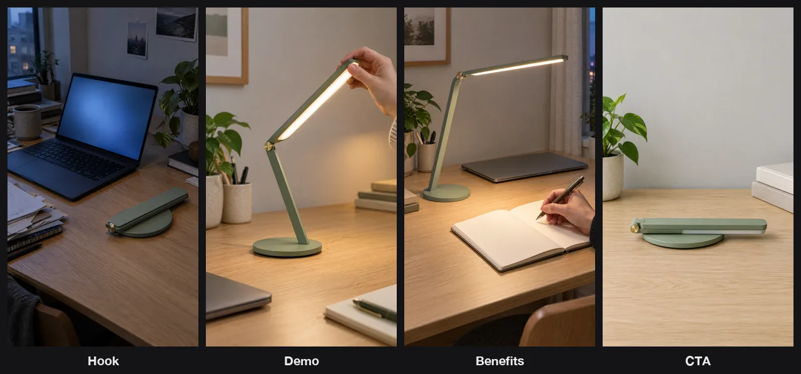

# Viral Video Remake Skill

[English](./README.md) | 简体中文

把一条跑出来的短视频拆成钩子、中段和转化引导，再把这套结构套到你自己的选题上，出分镜表、分镜图和口播，交付一条竖屏短片，或分段素材加字幕和带时间码的剪辑清单，在 Claude Code、Codex 或 OpenClaw 里直接完成。

> [!IMPORTANT]
> 生成需要 [Beatra](https://beatra.ai) 账号并消耗积分，安装本身不收费。

| 问题 | 回答 |
| --- | --- |
| **能做什么** | 粘一个视频链接，或者把文件截图交给它：把一条跑出来的短视频拆成钩子、中段和转化引导，再把这套结构套到你自己的选题上，出分镜表、分镜图、口播——镜头简单、时长在单条模型上限内就交付一条由开场画面动起来的竖屏短片，卡点多或时长超限就按分段交付素材，配一条完整口播音轨、字幕和带时间码的剪辑清单。 |
| **运行要求** | Python 3.10+，以及能加载 `SKILL.md` 的 Agent |
| **费用** | 安装免费。每次生成消耗 Beatra 账号积分，只有你明确要求这次生成或批准确认卡后才会付费。 |
| **支持的 Agent** | Claude Code、Codex、OpenClaw |

<p align="center"></p>

*按一个假设的“先讲痛点”短视频结构，为虚构的折叠台灯 Brightfold 重做的四张 9:16 分镜帧（钩子、演示、卖点、行动号召）。由 Beatra AI 生成。*

| Skill | Entry point | Version |
| --- | --- | --- |
| [`viral-video-teardown-remake`](skills/viral-video-teardown-remake) | [SKILL.md](skills/viral-video-teardown-remake/SKILL.md) | 0.3.9 |

本仓库由 [beatra-ai/beatra-skills](https://github.com/beatra-ai/beatra-skills/tree/main/skills/viral-video-teardown-remake) 自动发布，问题请到那里反馈。

## 安装

使用 [`skills`](https://skills.sh) CLI：

```bash
npx skills add beatra-ai/viral-video-remake-skill
```

使用 GitHub CLI：

```bash
gh skill install beatra-ai/viral-video-remake-skill viral-video-teardown-remake
```

也可以克隆本仓库，把 `skills/viral-video-teardown-remake` 复制到 `~/.claude/skills/`（Claude Code）、`~/.agents/skills/`（Codex）或 `~/.openclaw/skills/`（OpenClaw）。

或者把下面这段话发给你的 Agent：

```text
从 https://github.com/beatra-ai/viral-video-remake-skill 安装 viral-video-teardown-remake skill（目录 skills/viral-video-teardown-remake），然后按它的 SKILL.md 连接我的 Beatra 账号。
```

## 效果示例

<p align="center"></p>

[▶ 观看完整视频（MP4）](assets/full-1.mp4)

*虚构台灯 Brightfold 的 6 秒竖屏重做短片：钩子帧动起来，配四句旁白，依次讲钩子、演示、卖点和行动号召。由 Beatra AI 生成。*

提示词：

```text
Evening on a cramped desk. The folded sage-green desk lamp in the foreground slowly unfolds on its own: its single flat arm rises from the round base, the long flat light bar lifts open at the small brass hinge, and the light bar switches on with a warm white glow that brightens the desk. Slow gentle camera push-in toward the lamp. The laptop, papers, mug and plant stay still. Smooth, realistic product-video motion.
```

## 技术规格与输出限制

截至 2026-10-16。实时列表：https://docs.beatra.ai/zh/docs/models

- **上传** — 单个文件最大 100 MB；同时适用下方各模型的输入限制
- **文生图** — 10 个模型（Qwen Image 2.0 Fast、Qwen Image 3.0、Qwen Image 3.0 Pro、GPT Image 2.5 Flare、GPT Image 2.5 Sunburst、GPT Image 2、Wan Image 2.7 Fast、Qwen Image 2.0 Pro、Wan Image 2.7 Pro、MiniMax Image 01 Live）；PNG；单次最多 4 张；画布最大 16.8 MP
  - 16.8 MP（4K 档）：Wan Image 2.7 Pro（单次最多 4 张）；GPT Image 2.5 Flare、GPT Image 2.5 Sunburst、GPT Image 2（单次 1 张）
- **声音克隆** — 1 个模型（MiniMax Voice Clone）；样本 10–300 秒，最大 20 MB；需提交授权声明
- **语音合成** — 2 个模型（MiniMax Speech 2.8 HD、MiniMax Speech 2.8 Turbo）；FLAC、MP3、OPUS、PCM、WAV；40 种语言；采样率 8、16、22.05、24、32、44.1 kHz；单次最多 50000 字符
  - 语言（ISO 639 代码）：zh, yue, en, es, fr, ru, de, pt, ar, it, ja, ko, id, vi, tr, nl, uk, th, pl, ro, el, cs, fi, hi, bg, da, he, ms, fa, sk, sv, hr, fil, hu, no, sl, ca, nn, ta, af
- **视频理解** — 1 个模型（MiniMax M3）；单次 1 个文件；每个最大 50 MB；最长 360 秒；按 1 fps 抽帧
- **图生视频** — 9 个模型（wan2.7-i2v、wan3.0-video、minimax-h3、seedance-2-mini、happyhorse-1.1-i2v、seedance-2-fast、seedance-2、wan3.0-video-prime、seedance-2.5）；480p 至 4K；2–30 秒；画幅 16:9、1:1、21:9、3:4、4:3、9:16；MOV、MP4
  - 4K：seedance-2，最长 15 秒
  - 30 秒：wan3.0-video、wan3.0-video-prime、seedance-2.5，最高 1080p
  - 原生音频：wan2.7-i2v、minimax-h3
- **首尾帧生视频** — 8 个模型（wan2.7-i2v、wan3.0-video、minimax-h3、seedance-2-mini、seedance-2-fast、seedance-2、wan3.0-video-prime、seedance-2.5）；480p 至 4K；2–30 秒；画幅 16:9、1:1、21:9、3:4、4:3、9:16；MOV、MP4
  - 4K：seedance-2，最长 15 秒
  - 30 秒：wan3.0-video、wan3.0-video-prime、seedance-2.5，最高 1080p
  - 原生音频：wan2.7-i2v、minimax-h3
- **视频延长** — 7 个模型（wan2.7-i2v、wan3.0-video、seedance-2-mini、seedance-2-fast、seedance-2、wan3.0-video-prime、seedance-2.5）；480p 至 4K；2–30 秒；画幅 16:9、1:1、21:9、3:4、4:3、9:16；MOV、MP4
  - 4K：seedance-2，最长 15 秒
  - 30 秒：wan3.0-video、wan3.0-video-prime、seedance-2.5，最高 1080p
  - 原生音频：wan2.7-i2v
- **参考生视频** — 9 个模型（wan2.7-r2v、minimax-h3、wan3.0-video、happyhorse-1.1-r2v、seedance-2-mini、seedance-2-fast、seedance-2、wan3.0-video-prime、seedance-2.5）；480p 至 4K；2–30 秒；画幅 16:9、1:1、3:4、4:3、9:16、21:9、4:5、5:4、9:21；MOV、MP4
  - 4K：seedance-2，最长 15 秒
  - 30 秒：wan3.0-video、wan3.0-video-prime、seedance-2.5，最高 1080p
  - 原生音频：wan2.7-r2v、minimax-h3

## 为什么用 Beatra，而不是直接调用模型 API

- **一个账号用到本 skill 的全部模型** — 文生图 10；声音克隆 1；语音合成 2；视频理解 1；图生视频 9；首尾帧生视频 8；视频延长 7；参考生视频 9（截至 2026-10-16），一次 Beatra 登录即可使用，不必分别管理各家模型的 key。
- **花不花钱由你决定** — 只有你明确要求这次生成，或批准显示实时积分估算的确认卡后才会付费。
- **先策划，再生成** — skill 先帮你规划、指导和检查，再在 Beatra 上生成。
- **文件可以核验** — `skills/` 下的每个文件都与 cdn.beatra.ai 上的发布归档逐字节一致，每次推送前用 SHA-256 校验。
- **更新由你掌控** — 不含自更新程序；用安装时的工具更新。
- **在你的 Agent 里运行** — Claude Code、Codex、OpenClaw。

## 与同类方案对比

| | Beatra（本 skill） | [Clipcat-ai/clipcat-skill](https://github.com/Clipcat-ai/clipcat-skill) | [xianyu110/ecommerce-video-skills](https://github.com/xianyu110/ecommerce-video-skills) |
| --- | --- | --- | --- |
| 需要的账号或 key | 一个 Beatra 账号，不需要各家模型的 key | Clipcat 账号和 API key（[出处](https://github.com/Clipcat-ai/clipcat-skill/blob/7888594dfb5fea29e40a50077d51a7dade97f66f/README.md#L47-L58)） | 不需要 API key；用 Python 和 ffmpeg 在本地渲染（[出处](https://github.com/xianyu110/ecommerce-video-skills/blob/96c49b349b7d975bda8f05ce6669c1d33500c269/README.md#L41)） |
| 模型 | 文生图 10；声音克隆 1；语音合成 2；视频理解 1；图生视频 9；首尾帧生视频 8；视频延长 7；参考生视频 9 | 视频：Grok Imagine 1.5、Veo 3.1 Fast、Gemini Omni Flash、Seedance 2/2.5、Wan 3.0、MiniMax H3、HappyHorse 1.1（[出处](https://github.com/Clipcat-ai/clipcat-skill/blob/7888594dfb5fea29e40a50077d51a7dade97f66f/README.md#L108-L124)） | edge-tts 配音；图生视频模型可选（[出处](https://github.com/xianyu110/ecommerce-video-skills/blob/96c49b349b7d975bda8f05ce6669c1d33500c269/README.md#L41)） |
| 花钱前 | 只有你明确要求这次生成，或批准显示实时积分估算的确认卡后才会付费 | 视频任务扣积分前，先免费列出模型、时长和积分等清单，等你明确同意后才提交（[出处](https://github.com/Clipcat-ai/clipcat-skill/blob/7888594dfb5fea29e40a50077d51a7dade97f66f/README.md#L82)） | 未说明 |
| 支持的 Agent | Claude Code、Codex、OpenClaw | 能执行命令行的 Agent：Claude Code、Codex、WorkBuddy、OpenClaw、Cursor（[出处](https://github.com/Clipcat-ai/clipcat-skill/blob/7888594dfb5fea29e40a50077d51a7dade97f66f/README.md#L5)） | Claude Code、Codex、Cursor（[出处](https://github.com/xianyu110/ecommerce-video-skills/blob/96c49b349b7d975bda8f05ce6669c1d33500c269/README.md#L39)） |
| 安装 | `npx skills add beatra-ai/viral-video-remake-skill` | 安装 `clipcat` 命令行；OpenClaw 按 skill 清单自动安装（[出处](https://github.com/Clipcat-ai/clipcat-skill/blob/7888594dfb5fea29e40a50077d51a7dade97f66f/README.md#L19)） | `npx skills add xianyu110/ecommerce-video-skills`（[出处](https://github.com/xianyu110/ecommerce-video-skills/blob/96c49b349b7d975bda8f05ce6669c1d33500c269/README.md#L30)） |
| 许可证 | MIT-0 | 仓库里没有许可证文件（[出处](https://github.com/Clipcat-ai/clipcat-skill/tree/7888594dfb5fea29e40a50077d51a7dade97f66f)） | MIT（[出处](https://github.com/xianyu110/ecommerce-video-skills/blob/96c49b349b7d975bda8f05ce6669c1d33500c269/LICENSE)） |
| 最近更新 | 随每次发布更新（v0.3.9） | 2026-09-20（[出处](https://github.com/Clipcat-ai/clipcat-skill/commit/7888594dfb5fea29e40a50077d51a7dade97f66f)） | 2026-10-05（[出处](https://github.com/xianyu110/ecommerce-video-skills/commit/96c49b349b7d975bda8f05ce6669c1d33500c269)） |

事实核对于 2026-10-16。有误请到 [beatra-ai/beatra-skills](https://github.com/beatra-ai/beatra-skills/issues) 提 issue。

## 你能得到什么

- **拆的是结构，不是表面** — 按秒切出钩子、中段各功能段和转化引导，并判定它属于六类脚本结构里的哪一类。
- **说清到底靠什么跑起来** — 把结构层、内容层、呈现层分开归因，让你清楚哪一层才是真正能搬走的那层。
- **终点是能开拍的素材，不是一份报告** — 画面与口播分开写的分镜表、按静帧交付的分镜图、口播音轨，以及一条由开场画面动起来的竖屏短片，或者在卡点多、时长超出单条模型上限时改为按分段交付的素材，配好字幕和带时间码的剪辑清单。

## 适用场景

- **拆同行刚爆的那条** — 弄清对手为什么起量，用同一套结构做出你自己的版本。
- **把参考视频变成可复用格式** — 把收藏夹里的样片提炼成能反复套用的内容形状。
- **对标账号的爆款重做一遍** — 保留已被验证的节奏与段落顺序，把每一句主张换成你自己的。

## 常见问题

### 我需要准备什么？

一条参考短视频，加一句你这条要做什么。参考可以是一个视频链接、视频文件、关键画面截图、复制来的文案，或者你自己口述每一段发生了什么。

### 拆解到底给我看什么？

带秒级时间点的分段表、这条视频属于哪一类脚本结构、按贡献度排序的爆款归因，以及钩子强度、信息密度、节奏控制、主体呈现、情绪曲线、转化引导六个维度的评分，最后指出它哪里不够好、你的复刻可以在哪里赢它。

### 最后我拿到什么？

一份画面和口播分开写的分镜表、你选定段落的分镜图，以及自选音色的口播音轨。参考视频镜头简单、时长在单条模型上限内，就交付一条由开场画面动起来、配好整段口播的 9:16 竖屏短片，其余段落的分镜图按静帧交付，方便你剪进自己的版本；参考视频卡点更多，或时长超过单条模型上限，就改为交付每一段的分镜素材、同一条完整口播音轨、字幕，以及带时间码的剪辑清单，供你在自己的编辑软件里拼接。

## 更新与安全

自 2026 年 10 月的版本起，本 skill 不再包含自更新程序：它只运行你安装的文件，从不自行替换。
请用安装时的工具更新——`npx skills update viral-video-teardown-remake` 或 `gh skill update viral-video-teardown-remake`。
详见 skill 内的 `references/updates-and-security.md`。

## 许可证

[MIT-0](LICENSE)：可自由使用、修改和再分发，包括商用，无需署名；与这些 skill 在 ClawHub 上的条款一致。

## 相关链接

- 官网 — https://www.beatra.cn
- 文档 — https://docs.beatra.cn
- 控制台 — https://console.beatra.cn
- 给 AI Agent 读的说明 — https://www.beatra.cn/llms.txt（索引）· https://www.beatra.cn/llms-full.txt（全部 skill 合成一个文件）

- 微信小程序 — 国内用户微信扫码使用


